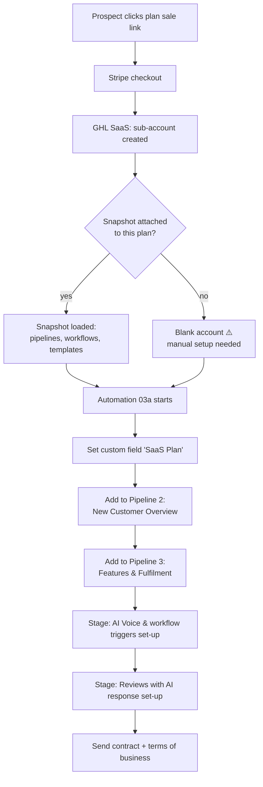

# 01: Provisioning workflow (current state)

## Purchase-to-account flow

## Steps in Automation 03a

| # | Step | Type |
|---|---|---|
| 1 | Create sub-account | SaaS (automatic) |
| 2 | Apply the correct SaaS plan | SaaS (automatic) |
| 3 | Load the correct snapshot | SaaS (automatic, if attached) |
| 4 | Update custom field "SaaS Plan" | Workflow action |
| 5 | Add client to Pipeline 2: New Customer Overview | Workflow action |
| 6 | Add client to Pipeline 3: Features and Fulfilment | Workflow action |
| 7 | Move to stage "AI Voice and WF Triggers (set up)" | Workflow action / human task |
| 8 | Move to stage "Reviews with AI Response (set up)" | Workflow action / human task |
| 9 | Send contract | Workflow action |
| 10 | Send terms of business | Workflow action |

## Key insight

**A feature being enabled is not the same as a feature being provisioned.** A plan's toggles make a feature *available* in the account. Whether it's *configured* (an AI voice agent with a phone number and script, a review-response workflow) depends on the snapshot or on human work. The audit treated those as two separate questions.
