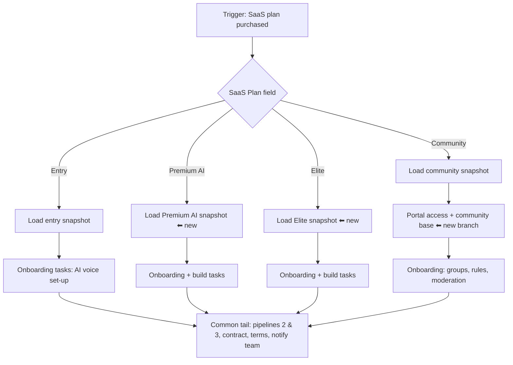

# 04: Target design

## Branching by plan

## Change list proposed

1. Build and attach snapshots for Premium AI and Elite.
2. Add a Community branch to Automation 03a.
3. For each branch, create onboarding-call and build-team tasks from the responsibility model.
4. Notify the team on purchase (internal message plus a task) so no new account waits.
5. Document which limits the platform enforces and which governance enforces.

## Sign-off process

Owner and build team review the matrix → agree the A/B/C split per plan → update Automation 03a → test-purchase each plan in Stripe test mode → check the account contents against the offer.
